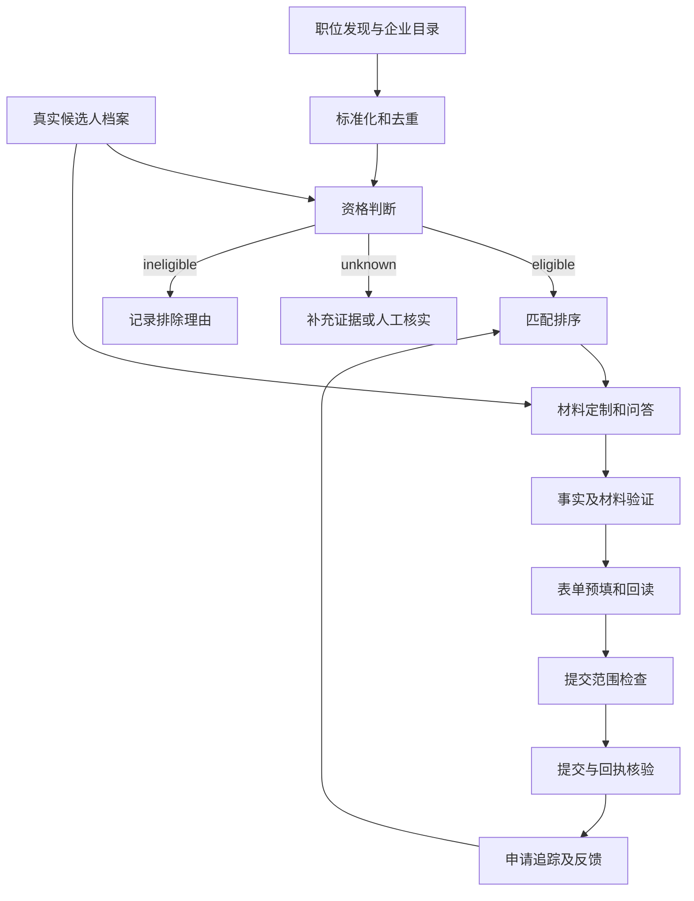

# Skill Map

这里的 skill 指系统的领域能力与工作流契约，不是已安装插件。**已实现部分 M1 原型，尚无可执行 SKILL.md。** S02 已接入两个只读来源，S03 实现精确去重与快照，S04 实现保守的部分硬规则，S01 增加带来源页码的事实库与双方向画像；S05 增加方向词项和事实证据映射；S06/S08 仅有本地材料准备单及版本 hash，现可基于带事实 hash 的私有英文表述库生成内容草稿和中英对照；尚无正式导出/完整校验。另已实现 JD 显式片段摘录及版本化人工审核、批量准备队列。申请/提交能力仍为 planned。下表是完整目标契约，不代表全部达标。 稳定流程验证后才封装成可调用技能，避免把提示词当成可靠系统。

## 能力分层

## 能力契约

| ID / 能力 | 输入 → 输出 | 实现边界 / 依赖 | 首轮验收 | 优先级 |
| --- | --- | --- | --- | --- |
| S01 Profile Evidence | 用户资料、确认记录 → 版本化 profile + facts + answer library | 本地结构化存储；模型只建议抽取；未知不得补造 | 每项履历陈述有 fact ID；未知授权保持 null | P0 |
| S02 Source Discovery | 来源登记、目标公司 → 原始职位快照、企业 ATS 目录 | API/RSS/用户 URL；S01 的偏好只影响搜索范围 | 两来源可入库；保留 URL、时间、来源 ID；失败不冒充零岗位 | P0 |
| S03 Normalize & Deduplicate | 原始职位 → canonical job + source aliases | 代码优先；依赖 S02 | 同 ATS ID 跨来源归一；近似岗位不盲目合并 | P0 |
| S04 Remote Eligibility | profile + JD 原文/结构字段 → eligible/ineligible/unknown + 理由/证据 | 规则判定，模型提取证据；依赖 S01/S03 | US-only 冲突能拦截；只写 remote 不能通过；未知可补证后重算 | P0 |
| S05 Match & Rank | eligible job + facts + preferences → 分项得分、缺口、推荐理由 | 先硬过滤再评分；依赖 S04 | 分数可复算，缺技能明确列出；分数不是录用概率 | P0 |
| S06 Tailor Materials | job snapshot + confirmed facts → 英文简历/求职信草稿及差异 | 仅选择与改写事实；依赖 S01/S05 | 日期、公司、学位、数字不漂移；每句事实有映射 | P0 |
| S07 Answer Questions | 问题、上下文、答案库 → 确认值或待回答项 | 授权/身份/薪资等直接取已确认值；依赖 S01 | 不推断国籍或授权；未知必填题不自动猜答案 | P0 |
| S08 Validate Package | 材料、映射、JD → 校验报告 + artifact hash | 代码检查 + 人工审阅；依赖 S06/S07 | 联系方式、附件文本、页序及事实一致；阻止占位符外发 | P0 |
| S09 Fill ATS Form | 已校验材料包、允许的页面 → 预填结果 + 字段回读 + 待处理项 | 站点适配器优先；依赖 S08；填写/上传可能立即外发数据 | 一类 ATS 样本中必填项逐项核验；未知页面转接管 | P1 |
| S10 Submit & Reconcile | 授权范围、字段摘要、材料 hash → receipt / failed / unknown | 原子去重、锁、回执核验；依赖 S09 | 已有提交/结果未知不重复；点击后超时进入对账队列 | P1 |
| S11 Track Outcomes | receipt、人工状态、经授权邮件 → application events | 初期手动；邮箱接入后只同步授权范围 | 自动回执不计面试；邮件按 job/company/application 关联 | P1 |
| S12 Evaluate & Improve | 运行与结果日志 → 分来源漏斗、成本、改进建议 | 代码统计；依赖 S02–S11 | 有明确分母和观察窗口；修正偏好不改写既有历史 | P1 |

## 所有能力共用的返回约定

每次运行记录 `run_id / capability_id / input_versions / output_refs / status / evidence_refs / started_at / finished_at / cost / error_code`。状态为 `ok / needs_input / failed / skipped`；申请提交状态另见架构文档。

事实记录至少含 `fact_id / value / source_ref / confirmed_at / confirmed_by`。JD 证据记录 `job_snapshot_id / field / quote / source_url / observed_at`；quote 仅保存判断所需短片段。资格结论包含规则版本和冲突说明。

## 何时使用模型

适合模型：把 JD 转成候选字段、语义匹配、选择相关经历、生成表达草稿、解释未知表单问题。输出必须通过结构校验。

使用代码：日期/货币处理、去重、枚举验证、硬规则、费用上限、授权匹配、幂等锁、状态转移和回执检查。

需要用户补充：缺失履历事实、工作授权、所在地、薪资期望、雇佣偏好和必须真实回答的筛选题。已确认答案可以在适用范围内复用。

## 后续技能封装模板

每个实际技能应说明触发条件、非适用场景、必需输入、确定性步骤、输出格式、异常处理、外部副作用和验收样例。先实现 S01–S05 的离线闭环，再考虑技能目录；MVP 不需要多个自治 Agent 相互协调。
