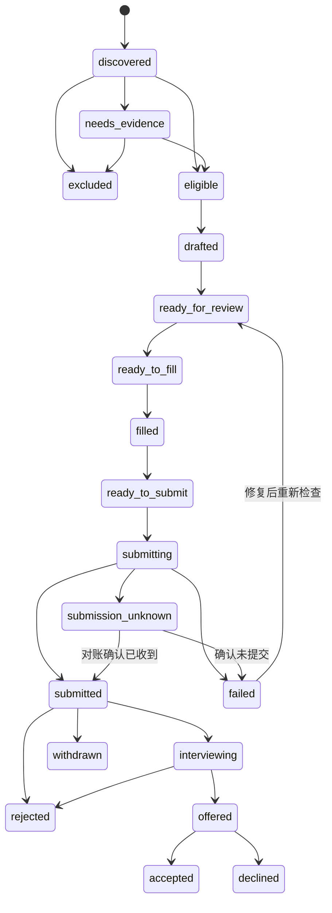

# 架构基线

状态：设计提案，尚未实现。推荐路线 C，单用户、本地优先。产品边界见 [Mission](../MISSION.md)，依据见 [Research](RESEARCH.md)。

## 模块与技术取舍

建议未来迁移到 TypeScript；使用 SQLite 存结构化状态、私有目录保存材料和必要证据、单进程调度器运行任务。采用模型提供方无关的接口，不在领域逻辑中绑定某个模型名称。具体依赖版本在实施时验证并锁定。

```text
source adapters -> raw snapshots -> normalizer/dedup -> eligibility -> ranker
                                                               |
profile + confirmed facts + answer library -> material builder <-+
                                                 |
                                           package validator
                                                 |
                                      local review / policy check
                                                 |
                                         ATS browser adapter
                                                 |
                                  receipt verifier -> application events
```

不必一开始引入 Redis、向量数据库、云浏览器或微服务。需要并发和多租户时再引入 Postgres 与持久化队列。评分和事实检索可先用结构化字段与关键词，数据量和召回评估证明需要后再加 embedding。

## 核心数据模型

| 实体 | 关键字段与约束 |
| --- | --- |
| CandidateProfile | id、version、residence_country、timezone、work_authorizations、employment_preferences、languages、availability；未知 null |
| Fact | id、profile_version、type、value、source_ref、confirmed_by、confirmed_at；未确认事实不能进入最终材料 |
| Answer | normalized_question、answer、scope、fact_ids、confirmed_at、expires_at；“需要 sponsorship”按国家/雇佣上下文限定 |
| Company | id、name、domain、ats_type、board_id、careers_url、verified_at；不从名称相似直接合并 |
| SourceListing | source_id、external_id、source_url、fetched_at、published_at、raw_hash、snapshot_ref、canonical_job_id |
| Job | id、company_id、ats_posting_id、title、apply_url、remote_type、allowed_countries、excluded_countries、timezone_constraints、employment_type、salary、status |
| JobSnapshot | id、job_id、observed_at、description_hash、content_ref；材料绑定不可变快照 |
| Eligibility | job_snapshot_id、profile_version、rule_version、status、reasons、evidence_refs；唯一关联本次判断 |
| Match | job_snapshot_id、profile_version、score_components、missing_requirements、scoring_version |
| Artifact | id、job_snapshot_id、profile_version、template_version、model_version、fact_map、file_hash、validation_status |
| Application | id、candidate_id、canonical_job_id、state、artifact_ids、policy_version、submitted_at；candidate + canonical job 唯一主记录 |
| Attempt | id、application_id、attempt_no、idempotency_key、lease_until、started_at、finished_at、status、error_code |
| Receipt | application_id、attempt_id、kind、confirmation_ref、observed_at、evidence_ref；证据区分自动和人工确认 |
| Event | entity_id、event_type、actor、timestamp、previous_state、next_state、payload_hash；追加写入 |

企业目录由用户目标公司清单、聚合岗位的官方申请链接和经验证招聘页逐步扩充。没有可信 board ID 时进入待核验目录，不能靠猜测批量调用所有公司名字。

## 标准化与去重

第一层 `source_id + external_id` 避免重复采集；第二层优先 `ats_type + board_id + posting_id` 跨源归一；第三层比较可信企业域名、职位名称、地点和文本，仅标记疑似重复，保留人工拆分能力。

原 URL 保留；只在用于匹配的副本中移除已知跟踪参数，不能删除决定岗位身份的 query 参数。保留 aggregator 的署名/回链和雇主原始申请 URL。多个 location posting 是否属于同一岗位需核实，不能仅按公司+title 合并。

过期、关闭和暂时请求失败分开处理。提交前重查职位是否开放及 JD 是否发生实质变化。重发布不会自动抹除申请历史。

## Remote 资格规则

逐项输出 `pass / fail / unknown / not_applicable`；存在 fail 则整体 ineligible；无 fail 但任一必要项 unknown 则整体 unknown；其余才为 eligible。依据必须是用户确认事实及岗位/雇主证据。

| 维度 | 判定方法 |
| --- | --- |
| 工作方式 | remote 与 hybrid/onsite 分开；不满足用户硬要求则 fail |
| 居住地 | 优先明确允许/排除国家；空字段为 unknown；Worldwide 标签仍与 JD 限制交叉核对 |
| 时区 | 按用户可用时段与雇主要求计算重叠；使用 IANA 时区考虑夏令时；只有笼统标签时待核实 |
| 工作授权 | 依据指定雇佣国家的已确认授权和 sponsorship 要求；不按国籍、英语水平推断 |
| 雇佣方式 | employee/contractor/EOR 分开；用户愿意 contractor 不代表雇主支持该所在地 |
| 必要资格 | JD 明确硬要求的证书、语言、经验等；未知不伪造，软偏好放评分 |
| 薪资 | 已知上限低于用户硬底线则 fail；币种/周期缺失时不比较；缺薪资默认待了解，不强行淘汰，取决于用户设置 |

冲突证据（聚合源写 Worldwide、JD 写 US only）不得由高匹配分覆盖，进入核实或按明确限制排除。

排序只用于 eligible 岗位：初始建议技能 35%、经验职责 30%、用户偏好 20%、新鲜度 15%。各分项 0–100，权重版本化；缺信息单独展示，不输出“录用概率”。资格 unknown 单列，不和可提交队列混合。

## 申请状态机



中间状态还允许显式 `paused/closed` 事件；恢复时回原阶段重新检查前置条件。未收到回复不是 rejected。

`ready_to_fill` 要求用户已授权向该站点提供相关资料；在线填表/上传可能被自动保存，不能称为“完全本地 dry-run”。`ready_to_submit` 要求表单回读通过、必填题完整、职位仍有效、权限范围及预算有效。

提交授权可逐份确认，也可以是用户明确设定的批量规则。绑定候选人版本、职位/域名范围、材料 hash 或允许的生成规则、次数和有效期；事实变更、出现新必填声明或越界时重新评估。网页勾选条款、营销订阅、敏感声明均不得静默猜选。

## 提交一致性和失败恢复

1. 在数据库事务中检查同岗位历史状态、领取任务租约并创建唯一 attempt；不能并行提交同一申请。
2. 点击前落盘 `submitting` 和材料/字段摘要。成功页、可信 application ID 或可关联的确认邮件才能形成 receipt。
3. 点击后网络超时、浏览器崩溃、进程重启一律按可能已产生副作用处理：进入 `submission_unknown`，阻止自动重投。
4. 对账优先查已有回执/账户记录，经授权可查确认邮件；无自动查询能力时人工核实。确认未收到后才重试。
5. 只读采集可退避重试，遵守 Retry-After；提交重试不能沿用简单“失败就再点”。CAPTCHA、2FA 或页面结构变化进入人工接管，不无限循环。

## 适配器接口（设计契约）

```text
SourceAdapter.fetch(cursor, filters) -> listings, nextCursor, fetchedAt, errors
SourceAdapter.normalize(listing) -> normalizedJob, provenance
AtsAdapter.inspect(jobUrl) -> fields, attachments, questions, pageSignature
AtsAdapter.fill(validatedPackage, permissionScope) -> observedFields, unresolved
AtsAdapter.submit(approvedAttempt) -> receipt | definiteFailure | unknown
AtsAdapter.reconcile(attempt) -> receipt | confirmedNotSubmitted | unresolved
```

每个适配器公开支持版本、限流策略和支持能力。Greenhouse/Lever 的企业提交 API 不是默认实现路径；普通求职者走官方页面，除非确实具备合法提供的对应凭据。

## 材料、隐私与外部内容

主档案和附件位于 `private/`，不进入 Git。只给模型处理当前任务需要的字段；不把密码、完整浏览器状态或无关个人数据塞进提示词。浏览器会话使用专用存储；日志默认脱敏，不记录 token、Cookie 或整份个人简历。

JD、网页、邮件均视为不可信数据。它们可以提供职位要求，但不能改变系统权限、运行 shell、导出文件或发送额外消息。申请要求中需要附加说明的内容应成为可见的待审项目。

材料校验含日期、联系方式、事实映射、占位符、附件格式和可提取文本；实际生成 PDF/DOCX 时要做视觉检查。回执截图只保留必要区域，默认建议 30 天后删除；结果台账建议 180 天后复核保留需求。这些均为待确认的本地默认策略。
